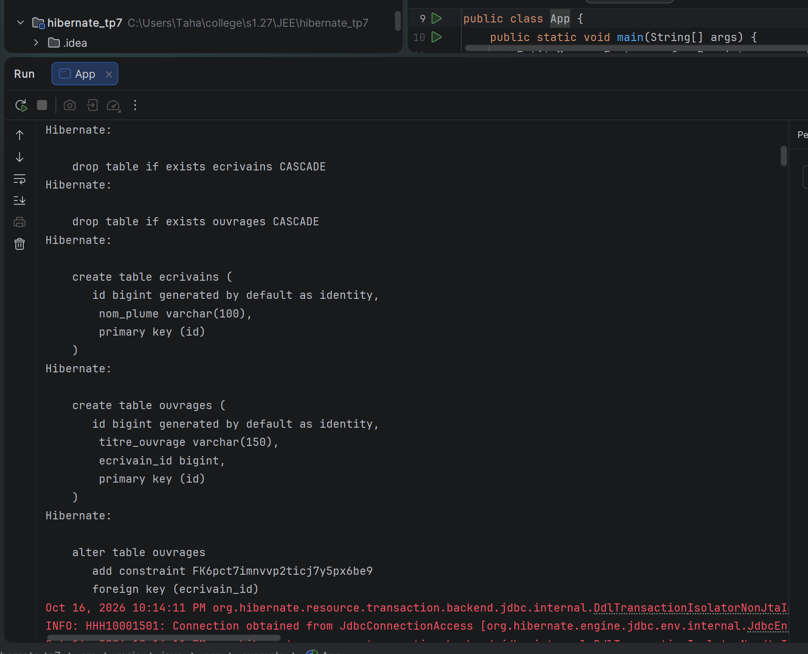
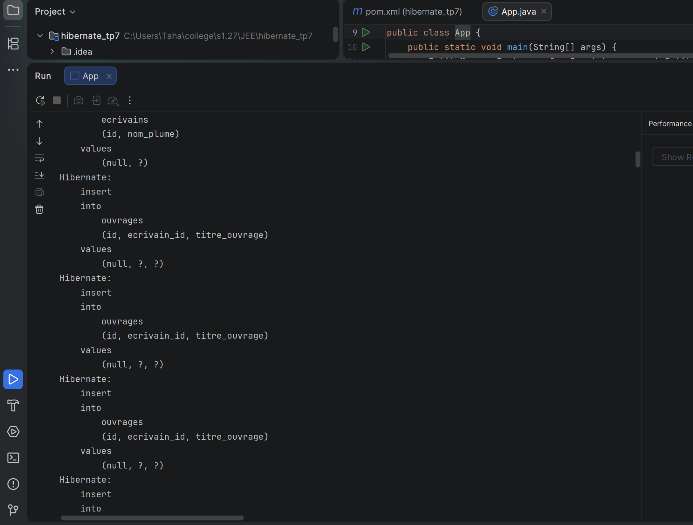
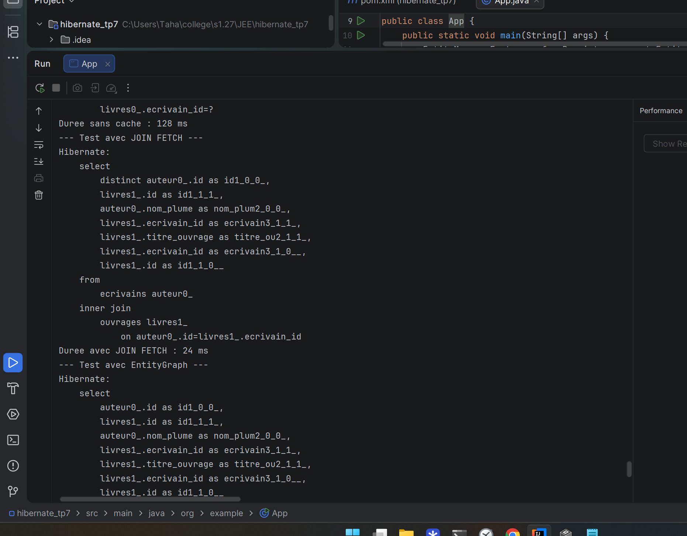
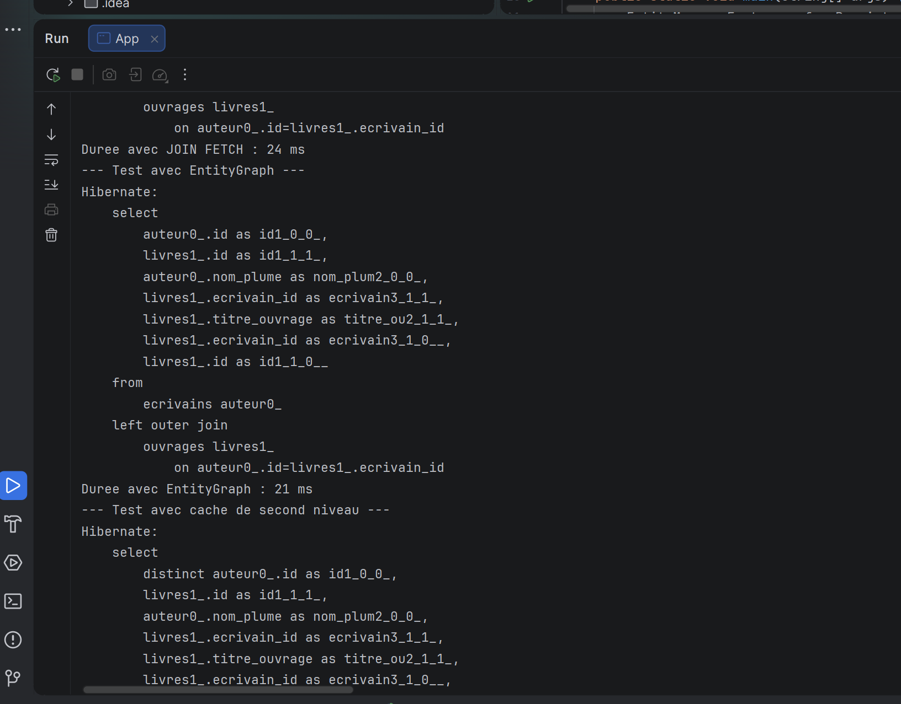
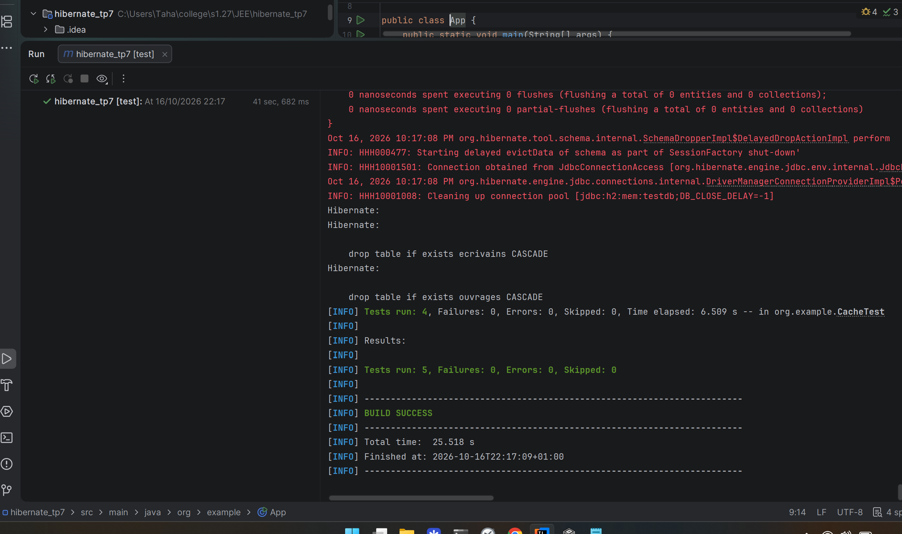

TP7 cache second niveau, 10 ecrivains avec 5 ouvrages chacun, H2 en memoire, create-drop, show_sql, L2 + query cache avec Ehcache, statistiques activees.

```console
Oct 16, 2026 10:11:34 PM org.hibernate.Version logVersion INFO: HHH000412: Hibernate ORM core version 5.4.32.Final
Oct 16, 2026 10:11:34 PM org.hibernate.dialect.Dialect INFO: HHH000400: Using dialect: org.hibernate.dialect.H2Dialect
Hibernate: drop table if exists ecrivains CASCADE
Hibernate: drop table if exists ouvrages CASCADE
Hibernate: create table ecrivains (id bigint generated by default as identity, nom_plume varchar(100), primary key (id))
Hibernate: create table ouvrages (id bigint generated by default as identity, titre_ouvrage varchar(150), ecrivain_id bigint, primary key (id))
Hibernate: alter table ouvrages add constraint FK6pct7imnvvp2ticj7y5px6be9 foreign key (ecrivain_id) references ecrivains
```

Demarrage et creation des tables ecrivains et ouvrages :



Insertion des 10 ecrivains Yassine Karim Salma Omar Sara Mehdi Nadia Bilal Rania Adam avec leurs 5 livres Python, puis lecture sans optimisation qui montre le N+1 avec 1 select auteurs + 10 selects ouvrages :

```console
Hibernate: insert into ecrivains (id, nom_plume) values (null, ?)
Hibernate: insert into ouvrages (id, ecrivain_id, titre_ouvrage) values (null, ?, ?)
--- Test sans cache ---
Hibernate: select auteur0_.id, auteur0_.nom_plume from ecrivains auteur0_
Hibernate: select livres ... from ouvrages where ecrivain_id=? (x10, une par auteur)
Duree sans cache : 569 ms
```



Lecture avec JOIN FETCH, une seule requete avec jointure, plus de N+1 :

```console
--- Test avec JOIN FETCH ---
Hibernate: select distinct auteur0_, livres1_ from ecrivains auteur0_ inner join ouvrages livres1_ on auteur0_.id=livres1_.ecrivain_id
Duree avec JOIN FETCH : 68 ms
```



Lecture avec EntityGraph Auteur.livres sans toucher au JPQL, puis double lecture pour le cache L2 avec hits dans les statistiques :

```console
--- Test avec EntityGraph ---
Hibernate: select auteur0_ ... from ecrivains auteur0_ left outer join ouvrages livres1_ on auteur0_.id=livres1_.ecrivain_id
Duree avec EntityGraph : 67 ms
--- Test avec cache de second niveau ---
Hibernate: select distinct auteur0_, livres1_ from ecrivains inner join ouvrages (lecture 1)
Session Metrics { 70 L2C puts; 1 L2C hits }
Duree avec JOIN FETCH : 31 ms
Duree avec cache (lecture 2) : 65 ms
```



Tests JUnit, init 10/50, JOIN FETCH, EntityGraph et L2, tout passe :

```console
Tests run: 4, Failures: 0, Errors: 0, Skipped: 0 -- in org.example.CacheTest
Tests run: 5, Failures: 0, Errors: 0, Skipped: 0
BUILD SUCCESS
```


